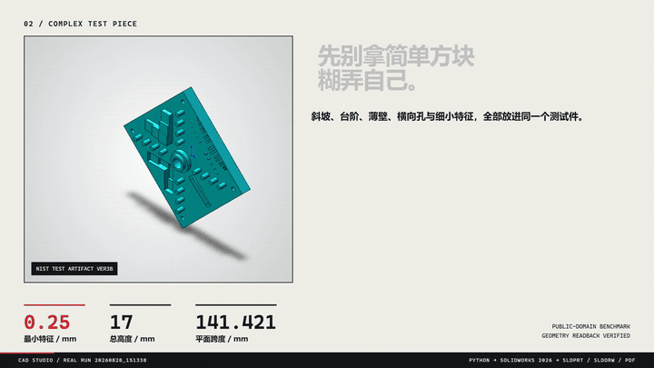

# SolidWorks Automation Skill

**AI Skill + MCP toolkit for reliable desktop CAD automation.**

Codex, Claude, Cursor ve diğer Agent'ların doğal dil aracılığıyla gerçek CAD yazılımını çağırmasını ve yürütme sonuçlarını doğrulayıp izlemesini sağlar.

> Tool success is not treated as task success.

Araç çağrısının başarılı olması, görevin gerçekten tamamlandığı anlamına gelmez; Review gerektiren görevler, sonuç doğrulandıktan sonra teslim edilir.

Mevcut yayın sürümü **v2.0.1**'dir: yetenek ZIP'i, CAD Studio kurulum sürümü ve taşınabilir sürüm aynı sürüm numarasını taşır ve aynı sürümdeki çalışma zamanını içerir. İndirme girişi ve yükseltme talimatları için bkz. [v2.0.1 sürüm notları](docs/releases/v2.0.1.md).

CAD Studio, tüm üretim yürütücüleri için teslim dosyalarının bu turda yeni oluşturulup oluşturulmadığını veya içeriğinin değişip değişmediğini tek biçimde denetler; eski dosyaların teslimi reddedilir, kanıtı yetersiz olanlar yeniden incelemeye alınır. Tarama kapsamı, uyumluluk ve doğrulama yöntemi için bkz. [bu turun teslim kapısı](references/delivery-freshness.md).

[](https://opensource.org/licenses/MIT)
[](https://www.python.org/downloads/)
[](https://github.com/wzyn20051216/solidworks-automation-skill/releases)
[](https://github.com/wzyn20051216/solidworks-automation-skill)
[](mcp-server/README.md)
[](https://github.com/wzyn20051216/solidworks-automation-skill/actions/workflows/windows-release.yml)

```text
User → Agent (Codex / Claude / Cursor) → Skill / MCP → Execution Core → CAD → Artifacts + Evidence
```

AI, amacı anlamaktan, API'yi doğrulamaktan ve adımları planlamaktan sorumludur; Execution Core ise yürütme sürecinin izlenebilir, doğrulanabilir ve hatalardan kurtarılabilir olmasını garanti eder.

---

## See It In Action

<p align="center">
  
</p>

Gerçek bir akış: doğal dil gereksinimi → Agent Skill'i çağırır → SolidWorks yerel `SLDPRT + SLDDRW` üretir → PDF dışa aktarılır → ölçüler ve kanıtlar otomatik olarak yeniden incelenir.

| Senaryo | Yetenek | Durum |
|---|---|---|
| [M6×1 gerçek dişli delik](subskills/solidworks-threaded-holes/README.md) | Metric Tap Thread, yeniden oluşturma sonrası geri okuma | `verified` |
| [CNC çok yuvarlatmalı/pahlı montaj yuvası](subskills/solidworks-fillet-chamfer-cnc/README.md) | anlamsal kenar seçimi, değişken yarıçap, face/full-round/setback | `stable` |
| [Standart involüt düz dişli](references/gears.md) | modül/diş sayısı/basınç açısıyla sürülen katı model | `pilot` |

---

## Prerequisites

| Öğe | Gereksinim | Denetim yöntemi |
|---|---|---|
| İşletim sistemi | Windows 10/11 x64 | Yerel `SLDPRT` / `SLDASM` / `SLDDRW` SolidWorks COM'a bağlıdır; diğer sistemlerde yalnızca açık format yetenekleri kullanılabilir |
| Python | 3.10+ (bu makinedeki gerçek donanım kabulü 3.12 kullanır) | `python -V` |
| Node.js | 20+ (workbench, MCP kaydı ve Skill yükleyicisi) | `node -v` |
| Git | Herhangi bir yeni sürüm (yükleyici `git clone` / `git pull` ile depoyu alır ve günceller) | `git --version` |
| SolidWorks | 2024 veya 2026, geçerli lisans gerekir | `python scripts/cad_doctor.py` |
| AutoCAD | İsteğe bağlı, yalnızca DWG/DXF alt yeteneği için gerekir | — |

Python bağımlılıklarını yükleyin:

```powershell
python -m pip install -r requirements.txt
# Yalnızca açık format (OCCT) yetenekleri için gereklidir:
python -m pip install -r requirements-occt.txt
```

Salt okunur ortam öz denetimi (CAD'i açmaz veya kapatmaz):

```powershell
python scripts/cad_doctor.py           # algılanan kurulum yolları, sürüm, COM kayıt durumu
python scripts/sw_capability_probe.py  # tür kitaplığı ve yetenek listesi
```

Şablonlar ve malzeme kitaplığı **varsayılan olarak otomatik algılanır**, sabit yol yazılmasına gerek yoktur. Yalnızca standart olmayan kurulum konumları için
[`config/runtime.example.json`](config/runtime.example.json) ve `SOLIDWORKS_TYPELIB_DIRS` gerekir;
bkz. [`config/README.md`](config/README.md).

---

## Quick Start

Üç giriş noktasından **herhangi birini seçmeniz yeterlidir**, aynı anda başlatmanız gerekmez.

### Option 1 — Skill

```powershell
npx github:wzyn20051216/solidworks-automation-skill --target claude
```

Bu komut bu depoyu alır ve kök dizindeki `install.js` dosyasını yürütür (`package.json`'ın `bin` girişi).

**Varsayılan davranış (güvenlik öncelikli, 2026-10-28'den itibaren)**:

- Yalnızca skills dizini **zaten var olan** istemcilere kurulur (`.agents` / `.claude` / `.codex` / `.cursor` / `.openclaw`);
  hiçbiri algılanmazsa **sizin yerinize dizin oluşturmaz**, bunun yerine `--target` ile açıkça belirtmenizi önerir.
- Hedef dizin zaten var ancak **bu deponun git çalışma kopyası değilse** (elle yerleştirilmiş, arşivden çıkarılmış veya başka kaynaklı),
  **kurulum reddedilir ve hiçbir dosya silinmez**.
- Bu depo tarafından kurulan dizinler `git pull --ff-only` ile güncellenir; hızlı ileri alınamıyorsa **yalnızca rapor edilir, silinmez**.
- Varsayılan olarak Python bağımlılıkları otomatik yüklenir; Windows'ta Python 3.10+ yoksa winget ile geçerli kullanıcı için Python 3.12 yüklenmeye çalışılır. Başarısız olursa uyarı verilir; `--no-install-deps` bu davranışı kapatır.
- Windows dışı platformlarda varsayılan olarak reddedilir (SolidWorks COM kullanılamaz); açık format yeteneklerini kullanmanız gerçekten gerekiyorsa `--allow-non-windows` ekleyin.

| Parametre | İşlev |
|---|---|
| `--target claude,codex` | Belirtilen istemcilere kurar; `all` desteklenen tüm öğeler anlamına gelir |
| `--dry-run` | Yalnızca yürütülecek eylemleri yazdırır, diske yazmaz |
| `--install-deps` | `requirements.txt` + `mcp-server/requirements.txt` yükler (varsayılan) |
| `--no-install-deps` | Python'u ve Python bağımlılıklarını otomatik yüklemez |
| `--no-register-mcp` | MCP yapılandırma kaydını atlar (varsayılan olarak kaydeder, üzerine yazmadan önce otomatik `.bak-<zaman damgası>` yedeği alır) |
| `--force-reinstall` | Eski dizini önce `.bak-<zaman damgası>` olarak yeniden adlandırır, sonra yeniden kurar (**silmez**) |

Kurulum `git clone --depth 1` kullanır; yalnızca çalışma ağacını alır, tam geçmişi çekmez. Deponun tam çalışma ağacı yaklaşık 13 MB'tır;
bunun içindeki `apps/` (masaüstü kaynak kodu, yaklaşık 6 MB) Skill çalışmasıyla ilgisizdir.
`npx` mevcut ağ ortamında kullanılamıyorsa aşağıdaki Option 2'deki klonlama yöntemine geçin ve ardından `node install.js` komutunu çalıştırın.

### Option 2 — MCP

```powershell
git clone https://github.com/wzyn20051216/solidworks-automation-skill.git
cd solidworks-automation-skill
python -m pip install -r requirements.txt -r mcp-server/requirements.txt
node mcp-server/register_all_ai_mcp.js --help          # tüm parametreleri görüntüle
node mcp-server/register_all_ai_mcp.js --clients codex,claude-code,cursor
```

Kayıt betiği ilgili istemcinin MCP yapılandırmasına yazar ve yazmadan önce `.bak` yedeği oluşturur; `--strict` eklemek herhangi bir istemci başarısız olduğunda sıfır olmayan çıkış kodu vermesini sağlar.

### Option 3 — CAD Studio masaüstü sürümü

Windows kurulum paketini [GitHub Releases](https://github.com/wzyn20051216/solidworks-automation-skill/releases) adresinden indirin.

Masaüstü uygulaması yerel yürütücüyü başlatırken Windows'ta kullanılabilir bir Python 3.10+ yoksa, winget ile geçerli kullanıcı için Python 3.12 yüklemeye çalışır; yüklenemezse hata gösterir. Ortam tanılaması yine salt okunurdur. SolidWorks ayrıca kullanıcı tarafından yüklenmeli ve lisanslı olmalıdır; API doğrulaması için gereken 7-Zip, Python paketleri ve doğrulanabilir yerel API Help ihtiyaç halinde otomatik yapılandırılır, ayrıntılar için bkz. [`references/api-lookup.md`](references/api-lookup.md).

> **Choose one entry point. You do not need to run all three.**

| Giriş | Kimler için uygun | GUI gerekir | Tipik kullanım |
|---|---|---|---|
| **Skill** | skill içe aktarmayı destekleyen Agent istemcileri | Hayır | Doğal dille SolidWorks'ü yönlendirme |
| **MCP** | Codex / Claude / Cursor / Windsurf gibi MCP istemcileri | Hayır | Agent otomatik Tool Calling |
| **CAD Studio** | Projeleri/görevleri/önizlemeleri/teslimatları grafik arayüzle yönetmesi gerekenler | Evet | Masaüstünden görev gönderme |

Bu üçü **eşit düzeyde giriş noktalarıdır** ve aynı yetenek listesini (`capabilities.yaml`), betikleri ve kanıt sistemini paylaşır. Kurulumdan sonra ortam tanılaması için `python scripts/cad_doctor.py` kullanabilirsiniz; ayrıntılı kurulum ve CLI için bkz. [`docs/CAD_STUDIO_USER_MANUAL.md`](docs/CAD_STUDIO_USER_MANUAL.md).

---

## Why This Project

LLM planlar, ancak yaygın AI CAD otomasyonunda birkaç gerçek sorun vardır:

- LLM planlar, ancak masaüstü CAD yazılımını gerçekten kullanmaz
- Tool'un `success` döndürmesi görevin gerçekten tamamlandığı anlamına gelmez
- CAD API sürümleri, ortamlar ve Backend farklılıkları karmaşıktır
- Sabit Tool kümesi tüm mühendislik gereksinimlerini kapsayamaz
- Agent yürütme süreci genellikle izlenemez ve denetlenemez

Bu projenin çözümü:

| Sorun | Çözüm |
|---|---|
| Doğal dil → gerçek işlem | Skill / MCP gerçek COM ve backend'e bağlanır |
| Tool success ≠ Task success | Verification-first completion |
| Backend hatası | Backend Router + Recovery Decision |
| Yetenek eksikliği | Capability Gap → doğrulama için Agent'a geri verilir |
| Yürütme izlenemez | Yapılandırılmış Trace |
| Güvenilir mi | Golden Workflow Eval |

---

## Architecture

```text
User / Agent
  ↓
Skill / MCP
  ↓
Execution Core(Capability · Verification · Recovery Decision · Trace)
  ↓
Backend Router
  ↓
Python COM / C# / OCCT
  ↓
CAD Software
  ↓
Artifacts + Evidence
```

- **Root Skill** = genel yetenekler, kurallar ve yürütme altyapısı (bağlantı, modelleme, inceleme, MCP).
- **Subskills** = özel alan iş akışları (teknik resim, dişli delikler, CNC yuvarlatma, VibeCAD, AutoCAD); Root Skill tarafından ihtiyaç halinde çağrılır, kullanıcının elle başlatması gerekmez.
- **Execution Core** = iç güvenilir yürütme katmanı: birleşik durum, sonuç doğrulama, hata kurtarma kararları ve yürütme izleme. Bir iç uygulamadır, **bağımsız bir servis değildir ve kullanıcının başlatması gerekmez**.
- **Capability Gap** = bir yetenek bulunamadığında yapılandırılmış olarak `CAPABILITY_GAP` döndürür ve "yapılamaz" demek yerine doğrulama için Agent'a geri verir:

  ```text
  Existing Tools → Tool Composition → Backend Fallback → Capability Gap
    → Agent references / resmî API / SDK'yi doğrular → asgari uygulama → Verification
  ```

  Execution Core kendisi **bilinmeyen kodu otomatik olarak ağ üzerinden yürütmez**.

Ayrıntılar: [`docs/architecture/execution-core.md`](docs/architecture/execution-core.md)

---

## Reliability

Şu anda **43 deterministik güvenilirlik senaryosu** (12 nominal + 31 robustness) içermektedir;
normal yürütme, hata enjeksiyonu, backend geri dönüşü, yetenek boşlukları ve politika kapılarını kapsar; `golden-workflows.yaml` içindeki 12 workflow'dan türetilmiştir.

| Metric | Current baseline |
|---|---|
| Nominal workflow | 12/12 ilk geçiş(baseline v4, warning guardrail'e atanır, elle inceleme beklenir) |
| Injected false-completion cases | all detected |
| Escaped false completion | 0 in current deterministic benchmark |
| Regression suite | Mevcut plan B doğrulama kaydı için bkz. [Güvenilirlik onarımı ve kabul](docs/architecture/scheme-b-reliability.md) |

> Bu bir **deterministic engineering benchmark**'tır (Fake Handler/Reviewer + hata enjeksiyonu),
> üretim SLA'sı veya gerçek kullanıcı başarı oranı değildir. Ayrıntılar için bkz. [`docs/architecture/v2-evaluation.md`](docs/architecture/v2-evaluation.md).

### Doğrulama Sınırı(Verification Boundary)

Bu projede doğrulama üç katmana ayrılır ve **sonuçlar katmanlar arasında aktarılamaz**:

| Katman | Nerede çalışır | Neyi kapsar | Neyi kapsamaz |
|---|---|---|---|
| L1 çevrimdışı regresyon | Herhangi bir makine | `pytest` (tam, şu anda 1045 öğe), `evals/runner.py` (12 workflow / 43 scenario), yönetişim birim testleri (şu anda 93 öğe) | SolidWorks / AutoCAD süreci gerektiren her şey |
| L2 barındırılan CI | GitHub tarafından barındırılan `windows-2022` | L1 ile aynı, ayrıca ön uç/Rust derlemesi ve yayın sözleşmesi denetimi; iş adı `test-and-build`, `main`'in **tek zorunlu durum denetimidir** | Gerçek CAD yürütmesi |
| L3 gerçek CAD kabulü | **Yalnızca bakımcının kendi makinesi** (Windows 11 + SolidWorks 2026 SP01.1) | Golden beş turlu gerçek donanım, montaj/teknik resim/hareket simülasyonu gibi gerçek donanım regresyonları | Diğer makineler, diğer sürümler |

Açıkça belirtilmesi gereken üç nokta:

1. **Uzakta CAD gerçek donanım yürütme kanıtı yoktur.** Depoda kendi barındırılan Runner yoktur, `Windows CAD Regression` iş akışı elle tetiklenir ve
   **zorunlu denetim değildir**, şu anda çalıştırılamaz. "Uzaktaki CAD CI geçti" şeklindeki her ifade yanlıştır.
2. **Kendi makinede geçmek ≠ başka makinede geçmek.** Başka bir makineye geçerken `Prerequisites` ve `docs/CAD_STUDIO_USER_MANUAL.md` uyarınca yeniden öz denetim yapın,
   bakımcının kabul sonucuna doğrudan atıfta bulunmayın.
3. **L2'nin geçmesi ≠ yönetişim döngüsünün kapanması.** Zorunlu denetim yalnızca `main`'i korur; özellik dallarına yönelik PR'lar (stacked PR'lar dahil) bu kurala tabi değildir.

Yerel SolidWorks işlemleri şu anda destek ve kabul hedefi olarak **2026**'yı alır. Plan B mevcut yürütme mimarisini korur; hata durumlarını, yerel dizileri, kroki düzenlenebilirliğini ve belge aidiyetini onarır ve isteğe bağlı HTTP ile doğrulanabilir ürün geri alımı sunar.

**Tam mod 69 adlandırılmış araç sunar; varsayılan keşif modu yalnızca 3 arama girişi sunar** (`sw_search_tools` /
`sw_describe_tool` / `sw_call_tool`). Mevcut adlandırılmış araçlar uyumluluğunu korur; keşif modu
ihtiyaç halinde arama yapar; yazma işlemleri politika denetiminden geçer, onay davranışı ve güven sınırları yapılandırmaya bağlıdır. Mod değiştirme, onay ve geri alma için bkz.
[`mcp-server/README.md`](mcp-server/README.md).

---

## Capabilities & Status

| Category | Neler yapabilirsiniz | Durum |
|---|---|---|
| Modeling | Parça modelleme, kroki/ekstrüzyon/döndürme, dişli, sac metal, kaynaklı parça | `verified` + `pilot` |
| Assembly | Montaj, Mate, girişim denetimi, patlatılmış görünüm | `verified` |
| Drawing | GB/T teknik resim, ölçü zinciri, delik tablosu, BOM | `verified` + `pilot` |
| Export | STEP / STL / IGES / PDF / DXF / DWG | `verified` |
| Motion | Hareket simülasyonu, döner motor, sonuç kapısı | `pilot` |
| Design Audit | Nötr belge tasarım kuralları, temel karşılaştırma, vidalı mil/kayış motoru torku ön taraması | `pilot` |
| Drilling Panel | Panel delik konumu tanıma, referans ve teknik resim spesifikasyonu adayları | `pilot` |
| Tolerances | Görüntülenen ölçü toleranslarının salt okunur çıkarımı, CSV çıktısı | `pilot` |
| Rename Preview / Copy | Özellik yeniden adlandırma önizlemesi; sınırlı bağımsız parçaların ve tek yapılandırmalı iç içe montajların yeni ada kopyalanması | `pilot` |
| Sprocket | Yaklaşık zincir dişlisi geometri gösterim katı modeli, üretim diş profili değil | `pilot` |
| Spring | Açık uçlu, eşit hatveli dairesel telli yay katı modeli | `pilot` |
| FEA | CalculiX doğrusal/doğrusal olmayan çözüm orkestrasyonu ve denetimi | `pilot` |
| DFM / Routing | Üretim incelemesi, yönlendirme incelemesi | `pilot` |
| Surface / Mold | Sınırlı Loft/Sweep/Thicken, kalıp planı | `pilot` |
| AutoCAD | DWG/DXF iki boyutlu çizim, katman/ölçülendirme/önizleme | `verified` / `pilot` / `blocked` |
| Open-format | OCCT başsız olarak STEP/BREP/STL/OBJ/GLB vb. yazar | `verified` |

Durum seviyeleri (`capabilities.yaml` tarafından tanımlanır):

| Status | Anlamı |
|---|---|
| `verified` | Gerçek donanım doğrulaması tamamlandı, bilinen kapsamda kullanılabilir |
| `stable` | Uzun süreli regresyon kapsamı |
| `pilot` | Uygulandı ancak hâlâ elle inceleme gerekiyor |
| `blocked` | Mevcut ortam veya yetenek otomatik teslimata izin vermiyor |

Gerçek donanım temeli: SolidWorks 2024 / 2026, AutoCAD 2024. Doğrulanmamış yetenekler gözetimsiz teslimat olarak paketlenmez.

- Tam yetenek matrisi (her yeteneğin kesin seviyesi/sürümü/sınırları) → [`capabilities.yaml`](capabilities.yaml)
- Alan iş akışları → [`subskills/`](subskills/) · [`SUBSKILLS.md`](SUBSKILLS.md)

---

## No SolidWorks Installed?

SolidWorks yoksa bazı açık format görevleri yine de tamamlanabilir:

`STEP · IGES · BREP · STL · OBJ · GLB · DXF · SVG · PDF · PNG`

(OCCT/OCP yalıtılmış süreç üzerinden gerçek yazma.)

Ancak yerel `SLDPRT / SLDASM / SLDDRW` yine de geçerli bir SolidWorks ortamı gerektirir.

---

## Examples

[`examples/`](examples/) dizini, temel parçalardan montaj, teknik resim, Motion ve FEA'ya kadar çalıştırılabilir örnekler içerir.

---

## Documentation

| Topic | Link |
|---|---|
| MCP Setup | [`mcp-server/README.md`](mcp-server/README.md) |
| CAD Studio | [`docs/CAD_STUDIO_USER_MANUAL.md`](docs/CAD_STUDIO_USER_MANUAL.md) |
| Architecture | [`docs/architecture/execution-core.md`](docs/architecture/execution-core.md) |
| Reliability Eval | [`docs/architecture/v2-evaluation.md`](docs/architecture/v2-evaluation.md) |
| Capability Matrix | [`capabilities.yaml`](capabilities.yaml) |
| Subskills | [`SUBSKILLS.md`](SUBSKILLS.md) |
| API / Backend | [`references/`](references/) |
| Design audit / drive sizing | [`references/design-rule-check.md`](references/design-rule-check.md) · [`references/drive-sizing.md`](references/drive-sizing.md) |
| Drilling panel analysis | [`subskills/solidworks-engineering-drawing/references/drilling-panel-gdt.md`](subskills/solidworks-engineering-drawing/references/drilling-panel-gdt.md) |
| Native GD&T / structured drawing generation (SW2026 pilot) | [`subskills/solidworks-engineering-drawing/references/native-gdt.md`](subskills/solidworks-engineering-drawing/references/native-gdt.md) |
| Common datums / projected zones / extended GD&T (SW2026 pilot) | [`subskills/solidworks-engineering-drawing/references/gdt-extended-options.md`](subskills/solidworks-engineering-drawing/references/gdt-extended-options.md) |
| Tolerance extraction | [`references/tolerance-extraction.md`](references/tolerance-extraction.md) |
| Rename preview | [`references/rename-preview.md`](references/rename-preview.md) |
| Approximate sprocket | [`references/sprocket.md`](references/sprocket.md) |
| Open helical spring | [`references/spring.md`](references/spring.md) |
| Troubleshooting | [`references/troubleshooting.md`](references/troubleshooting.md) |

---

## Roadmap & Contributing

**Roadmap**: Daha geniş gerçek donanım doğrulaması · daha güvenilir yetenek yönlendirmesi · daha iyi CAD Studio gözlemlenebilirliği · daha fazla verified alt yetenek · topluluk katkı iş akışları.

**Contributing**: Yeni yetenek eklerken önce `capabilities.yaml` dosyasına bakın, mevcut backend'i öncelikli olarak yeniden kullanın, tests + evidence ekleyin ve doğrulanmamış capability'yi `verified` olarak işaretlemeyin. Ayrıntılar için bkz. [`CONTRIBUTING.md`](CONTRIBUTING.md).

---

## License & Community

[MIT](LICENSE) · [GitHub Issues](https://github.com/wzyn20051216/solidworks-automation-skill/issues) · [Star History](https://star-history.com/#wzyn20051216/solidworks-automation-skill&Date)

<picture>
  <source media="(prefers-color-scheme: dark)" srcset="https://api.star-history.com/svg?repos=wzyn20051216/solidworks-automation-skill&amp;type=Date&amp;theme=dark">
  
</picture>

---

## English

**SolidWorks Automation Skill** is an AI Skill + MCP toolkit for reliable desktop CAD automation. Codex, Claude, Cursor, and other agents drive real SolidWorks / CAD workflows through natural language, with verification, deterministic recovery decisions, and execution tracing. Three peer entry points — Skill, MCP, and CAD Studio — share one capability registry (`capabilities.yaml`). **Choose one; no extra runtime service is required.** See Quick Start above.

---

<sub>Douyin'de @balance. takip edin · Gömülü geliştirme, SolidWorks otomasyonu ve AI destekli mühendislik uygulamaları düzenli olarak güncellenir</sub>

### Montaj girişim denetimi API'si

`solidworks_interference_check`, `IAssemblyDoc.InterferenceDetectionManager` kullanır,
`GetInterferences()` ile hesaplar ve `IInterference.Components` ile hacmi okur, sonunda `Done()` çağırır.
Gizli katılar ve yok sayılan sonuçlar denetime katılır; aynı çok katılı parçanın kendi içindeki kesişimler hesaba katılmaz.
Hesaplama hatası, sayım okuma hatası, dizi sayısı tutarsızlığı veya denetimi bitirme hatası `blocked` döndürür ve yanlışlıkla sıfır girişim bildirmez.
Bastırılan bileşenler hesaplamaya katılmaz; sıfır sonuç yine de bileşen çözümleme durumunun ve tasarım amacının doğrulanmasını gerektirir.
Çevrimdışı regresyon çağrı sırasını, hata işlemeyi ve SI hacim dönüşümünü kapsar (26 öğe geçti).
SOLIDWORKS 2026 SP4.1 (34.4.1) ve Python 3.10 üzerinde MCP ile test edilerek normal yanıt döndürdüğü doğrulanmıştır;
bu gerçek donanım örneği sıfır girişimdir, sıfır olmayan sonuç okuma yine çevrimdışı regresyonu kanıt olarak alır.
