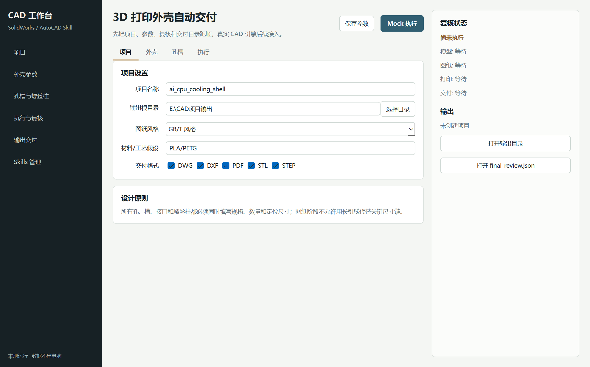

# CAD Otomasyonu Teslimat Çalışma Tezgâhı Masaüstü Prototipi

> **⚠️ Eski prototip (legacy)**
>
> Geçerli resmi masaüstü ürünü **`apps/workbench-ui/`** dizinidir (Tauri + React); kurulum paketini
> [GitHub Releases](https://github.com/wzyn20051216/solidworks-automation-skill/releases)
> üzerinden edinebilirsiniz. Bu dizin daha eski bir PySide6 prototipidir, **artık yayın hedefi değildir**; arayüzü ve etkileşimi geçerli ürünü temsil etmez.
>
> **Lütfen silmeyin.** `scripts/build_windows_release.ps1` hâlâ bu dizindeki
> `apps/desktop/cad_workbench/queue_worker.py` ve
> `apps/desktop/cad_workbench/schemas/automation_job.schema.json`
> dosyalarına bağımlıdır (görev kuyruğu uygulaması ve Schema kaynağı olarak resmi ürüne paketlenir). Arşivlemeden önce bu bağımlılık kaldırılmalıdır.
>
> Aşağıdaki içerik tarihsel kayıt olarak korunmaktadır; içindeki ekran görüntüleri ve kurulum adımları yalnızca prototipin kendisi için geçerlidir.

---

Bu, `solidworks-automation-skill` için ilk sürüm yerel masaüstü yazılım prototipidir.

Geçerli sürüm önce kullanıcı deneyimi döngüsünü uçtan uca çalıştırır:

```text
Yeni proje -> Parametreleri doldur -> JSON kaydet -> Mock yürütme -> İnceleme raporu ve teslimat dizini üret
```

Gerçek SolidWorks / AutoCAD otomasyonu sonraki sürümlerde aynı yürütme hattına bağlanacaktır.



Arayüz tasarım kuralları için `DESIGN.md` dosyasına bakın; geçerli görsel yön "sessiz mühendislik kontrol odası"dır: mühendislik kâğıdı arka planı, kömür siyahı navigasyon, tek bakır vurgu rengi, net P0 inceleme geri bildirimi.

## Bağımlılıkların Kurulumu

```powershell
python -m pip install -r apps/desktop/requirements.txt
```

## Başlatma

```powershell
python apps/desktop/run.py
```

Doğrudan PowerShell başlatma betiği de kullanılabilir:

```powershell
powershell -ExecutionPolicy Bypass -File apps/desktop/start_desktop.ps1
```

## exe Paketleme

```powershell
powershell -ExecutionPolicy Bypass -File apps/desktop/build_exe.ps1
```

Paketleme tamamlandıktan sonra yürütülebilir dosya şuradadır:

```text
apps/desktop/dist/CADAutomationWorkbench/CADAutomationWorkbench.exe
```

## Geçerli Yetenekler

- Yerel proje dizini oluşturma.
- Mevcut projeyi açma ve parametreleri geri doldurma.
- 3D baskı kabuğu parametre formu.
- Delikler, arabirim açıklıkları ve vida bosları için yapılandırılmış tablolar.
- Parametre bütünlüğü kontrolünü ayrı çalıştırma.
- `project.json` ve `parameters.json` çıktısı.
- Mock model, çizim, inceleme raporu, `manifest.json` ve teslimat notları üretimi.
- P0 kural kontrol sonuçlarının görselleştirilmesi.
- Sol navigasyondan kritik akışlara doğrudan geçiş veya çıktı dizini ile skill deposunu açma.

## Geçerli Sınırlamalar

- Henüz SolidWorks COM çağrılmıyor.
- Henüz AutoCAD COM çağrılmıyor.
- Üretilen CAD dosyaları mock yer tutuculardır; imalatta kullanılamaz.
- P0 kontrolü şu an parametre bütünlüğü ve dosya yapısına dayanıyor; gerçek model/çizim incelemesi daha sonra bağlanacak.
